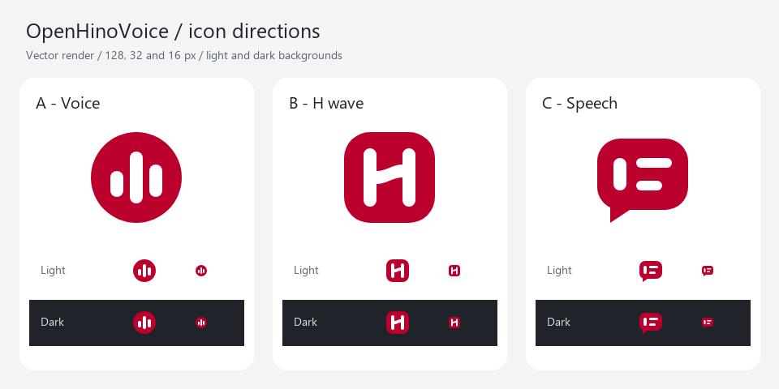
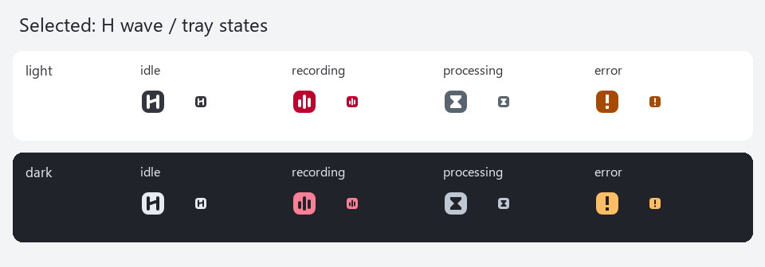

# OpenHinoVoice アイコンの制作・検証

2026-11-10。承認済みUI・UX計画のU08として制作した。アプリへの組込みは別タスクであり、この記録は画像資産の確認結果である。

## 採用した案

**B「H wave」**を採用した。丸みのある赤い面に、横棒がゆるく上がるHを置いた。既存の設定画面と同じ赤 `#BC002D` を使い、声の波形を1本の横棒へまとめた。名前の由来は追加していない。

| 案 | 判断 |
|---|---|
| A 円と音声バー | 小さくても読める。録音アプリ一般の記号に近く、識別要素が弱い。 |
| B Hと波形 | 16pxでもHの左右の縦棒と横棒が残る。波形を独立した飾りにせず文字の一部にできる。 |
| C 声から文字の吹き出し | 用途は分かりやすいが、16pxではチャットアプリの記号に近くなる。 |

初稿ではHの横棒を24単位上げていた。第2稿は16単位へ抑え、16px時の横棒の上下差を1pxに近づけた。Hの読みやすさを優先した修正である。余白は256単位の四方16単位、外形は224単位、角丸64単位、Hの縦棒は32単位。完成原本にフォント・画像・フィルター・マスク・グラデーションは使っていない。

探索では、円と3本のバー、円の切欠きに1本のバー、波形の横棒を持つH、Hの中央に点を置く案、丸いOと音声の切欠き、吹き出し内の縦棒と文字行、括弧状の声から文字行へ移る案、丸いタイルに入力カーソルを置く案を比較した。承認済みの3方向に沿うA・B・Cだけをベクターで制作した。





## 資産と接続方法

- [source.svg](../../../assets/branding/source.svg) はカラー原本。白いHは赤いタイルに載せる意図した配色で、背景を透かす穴ではない。
- [monochrome.svg](../../../assets/branding/monochrome.svg) と [reversed.svg](../../../assets/branding/reversed.svg) は、Hを実際の透明な穴にした単色版。
- [app.ico](../../../assets/branding/app.ico) は16・20・24・32・40・48・64・128・256pxの9サイズ。各フレームは32bit RGBAのPNG。Windows 11用。
- [settings.png](../../../assets/branding/settings.png) は256×256pxの透明PNG。
- [manifest.json](../../../assets/branding/manifest.json) は各資産の相対パス、SHA-256、bytes、サイズ、明暗別トレイの対応表。
- `tray/{light,dark}-{idle,recording,processing,error}.ico` は各7サイズ（16〜64px）。同名のSVG原本と32px PNGもある。
- トレイは待機=H、録音=3本の音声バー、処理中=砂時計、失敗=感嘆符。色を除いても形で区別できる。lightは明るい背景用、darkは暗い背景用。OSの高コントラスト対応と実トレイ表示は組込み側で確認する。

資産29ファイルの合計は **60,445 bytes**。原本・単色版・PNGとICOの重複を含む配布候補一式であり、128KiBの制作目安内。実際に埋め込むapp.ico、settings.png、8つのトレイICOだけなら **51,215 bytes**。exe全体や実メモリの増分は未測定である。比較画像とmanifestをexeへ埋め込まない。

## 実施した検証

- SVG構造監査。単色版・反転版は警告なし。カラー原本のwhite-knockout警告は、白いHを赤いタイルに載せる意図した配色として確認した。
- SVGをheadless Chromeでレンダリングした比較画像を2回確認した。生成AIの概念画を縮小して正式資産にはしていない。
- 16px・32pxの実寸、明るい背景・暗い背景でHと4状態の形を目視確認した。
- manifestの29ファイルの存在、bytes、SHA-256を検証した。
- ICO全65フレームのサイズ、ヘッダー、32bit、PNGペイロード、透明・不透明ピクセルを検証した。
- 16pxのトレイ4状態についてアルファ形状がそれぞれ異なることを両テーマで確認した。
- source/monochrome/reversedにテキスト・ラスタ画像・フィルター・スクリプト等を含まないことを検証した。
- Gitコミット、Cargo、音の再生、GUIアプリの前面起動は行っていない。アプリへの組込み、Windows Explorerでのexe抽出、実トレイのDPI切替、HICONの回収は未検証。

## 再生成

Python 3、Pillow、ChromeまたはEdgeを使う。外部ライブラリの取得は行わない。

```powershell
python scripts/generate-branding.py
python scripts/generate-branding.py --check
```

通常の生成は比較画像、選定SVGからの正式資産、manifestを再生成して検証する。`--check` はChromeを起動せず、現在の資産を検証する。各サイズをSVGから直接レンダリングし、ICOへ格納する。作業用ファイルと独立したChromeプロファイルは `target/branding-render/` に置く。Chromeはheadless、Windowsの子プロセスはCREATE_NO_WINDOWで実行する。

基準の3原案とBの第2稿は `assets/branding/concepts/` に残している。正式資産の修正はB第2稿のSVGから行う。生成スクリプトはそのパスを読み、ICO・PNG・単色版・トレイへ反映する。

## 概念画

内蔵imagegenで3方向の概念画を作り、その後ベクターで設計した。概念画はプレビュー専用で、正式資産の依存ではない。概念画のpromptは次の要素を指定した。

> OpenHinoVoice用の3案を白地に横並びで提示。左は赤い円と3本の白い音声バー、中は負形のHと波形の横棒、右は縦棒から文字行へ移る吹き出し。平面図形、少数の形、大きな空隙、16pxの判別性。マイク・旗・放射線・影・グラデーション・3D・装飾枠は避ける。

概念画の赤は仮色だった。正式原本は既存コードで確認した `#BC002D` に統一した。比較画像内の文字は説明用のSegoe UIで、正式マークには含まれない。
